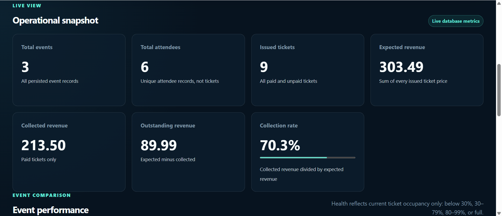
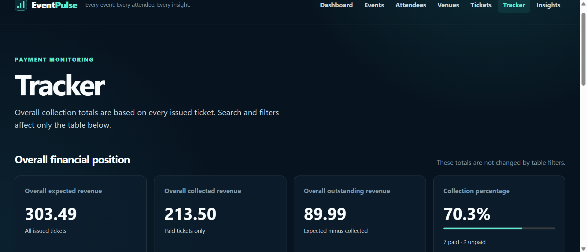
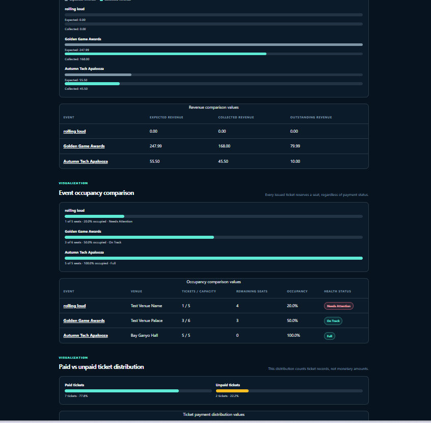

# EventPulse

EventPulse is an Event Operations & Revenue Intelligence application for one local event operator. It keeps venue capacity, event schedules, attendees, tickets, payment status, and operational reporting in one Django workspace. The workflow is deliberately simple: create operational records through the UI, issue reservations without overselling, then use the reporting pages to understand revenue and occupancy.

EventPulse has no authentication, accounts, user roles, payment gateway, or external-service dependency. It is designed for a single-operator local workflow.

## Implemented features

- Venue management with positive capacity validation and protected deletion when events exist.
- Event management, scheduling, venue assignment, search, filtering, sorting, and deletion confirmation.
- Attendee create, list, detail, edit, delete, search, and sorting workflows.
- Ticket create, list, detail, edit, and confirmed delete workflows.
- One ticket per Event/Attendee pair and server-side capacity enforcement for every ticket status.
- Manual payment-status actions: mark tickets paid with a payment date/method, or return them to unpaid.
- Financial Tracker with overall expected, collected, outstanding, and collection-rate metrics.
- Dynamic Dashboard KPIs and per-event occupancy, revenue, and health information.
- Occupancy-based Event Health and Insights comparisons/charts, including event filtering.
- A registered custom Django `money` template filter, used on reporting pages.
- A custom 404 page and a disabled informational event field in `PaymentForm`.
- Meaningful empty states and UI creation routes for an empty database.

For the detailed domain rules and the academic evidence map, see [the product specification](docs/PRODUCT_SPEC.md), [the requirements matrix](docs/REQUIREMENTS_MATRIX.md), and [the evaluator walkthrough](docs/EVALUATOR_WALKTHROUGH.md).

## Application Preview



*Dashboard — operational KPI cards and the beginning of the Event Health comparison.*



*Tracker — overall financial position before the filterable payment-record table.*



*Insights — accessible chart and table views for revenue, occupancy, and payment distribution.*

## Technology stack

- Python 3.13.17 was used for development.
- Django 6.1.3, pinned in `requirements.txt`.
- SQLite for local storage.
- Django Templates with local HTML/CSS and SVG assets.
- No heavy frontend framework and no third-party payment processor.

## Architecture

| Area | Responsibility |
| --- | --- |
| `events` | `Venue` and `Event` models; venue/event CRUD and schedule/capacity context. |
| `attendees` | Reusable `Attendee` directory and attendee CRUD. |
| `ticketing` | `Ticket` model, ticket/payment workflows, dashboard, tracker, insights, and presentation formatting. |
| `eventpulse` | Django project configuration, root URLs, and the custom 404 handler. |
| `templates/` and `static/` | Shared base layout, navigation/footer partials, 404 page, CSS, and favicon. |
| `ticketing/analytics.py` | Shared database aggregates for revenue, occupancy, and Event Health. |
| `*/migrations/` and `*/tests.py` | Versioned database schema and focused automated verification. |

Core relationships:

```text
Venue 1--< Event 1--< Ticket >--1 Attendee
                       ^
                       Event and Attendee are many-to-many through Ticket
```

## Installation and local startup

Prerequisites: Git and a Python 3.13 installation. SQLite is included with Python.

### Windows PowerShell

```powershell
git clone https://github.com/PlamenPlamenovStanchev/EventPulse.git
cd EventPulse
python -m venv .venv
.\.venv\Scripts\Activate.ps1
python -m pip install -r requirements.txt
python manage.py migrate
python manage.py runserver
```

Open <http://127.0.0.1:8000/>.

### macOS and Linux

Use the same commands, activating the environment with:

```bash
source .venv/bin/activate
```

If `python` does not refer to Python 3.13 on your system, invoke the appropriate Python 3.13 executable when creating the virtual environment.

## Configuration

No environment variable, `.env` file, external credential, fixture, or source edit is required for local startup.

- `DJANGO_SECRET_KEY` is optional locally. If absent, settings use the deterministic development-only fallback.
- `DEBUG` is currently hard-coded to `True` for local development.
- `ALLOWED_HOSTS` is currently an empty list.
- SQLite uses the project-local `db.sqlite3` database after migrations run.

This configuration is **not production-hardened**. A production deployment would need an environment-provided secret key, appropriate debug/host/security settings, and an operational deployment review; none is supplied by this repository.

## Verification

Run the following from the project root:

```powershell
python manage.py check
python manage.py makemigrations --check --dry-run
python manage.py test
```

The latest independently verified baseline before this documentation update was **158 passing tests**, with Django checks passing and no pending migrations. That result is historical evidence, not a fresh test run by this documentation task.

## Empty-database workflow

The application is designed to work immediately after `migrate`, without fixtures.

1. In **Venues**, create a venue with a capacity of at least one.
2. In **Events**, create an event and select that venue.
3. In **Attendees**, add an attendee record.
4. In **Tickets**, issue a ticket for the event and attendee.
5. From the ticket detail or **Tracker**, use **Mark as paid** or **Mark as unpaid** as appropriate.
6. Use **Tracker** to monitor payment records and financial totals.
7. Use **Dashboard** and **Insights** to review KPIs, occupancy health, and filtered event comparisons.

The primary navigation labels are Dashboard, Events, Attendees, Venues, Tickets, Tracker, and Insights.

## Business rules and reporting definitions

- Capacity is enforced **per Event** against that event's selected venue capacity.
- An attendee can have only one ticket for the same event.
- Both `PAID` and `UNPAID` tickets reserve capacity.
- Ticket price cannot be negative.
- A paid ticket requires a payment date and payment method; an unpaid ticket cannot retain payment metadata.
- Expected Revenue is the sum of all ticket prices.
- Collected Revenue is the sum of `PAID` ticket prices only.
- Outstanding Revenue is Expected Revenue minus Collected Revenue.
- Collection Rate is Collected Revenue divided by Expected Revenue (zero when expected revenue is zero).
- Event Health is occupancy-only: below 30% is **Needs Attention**; 30% to below 80% is **On Track**; 80% to below 100% is **Near Capacity**; exactly 100% is **Full**.
- Deleting an event cascades to its tickets. Deleting an attendee with tickets is protected; deleting a venue with events is protected.

## Known limitations

- SQLite cannot make the count-then-insert ticket-capacity check race-free for simultaneous writers.
- Payment tracking is manual; EventPulse is not a payment processor.
- The system stores current payment status and metadata, not a payment-history audit trail.
- Event Health describes current occupancy; it is not predictive and does not incorporate schedule or payment exposure.
- The included settings are for local development, not public production deployment.

## Repository and release checks

The configured repository URL is <https://github.com/PlamenPlamenovStanchev/EventPulse>. 

Do not commit secrets, `.env` files, local databases, or certificates. The repository's `.gitignore` covers these common local artifacts.
