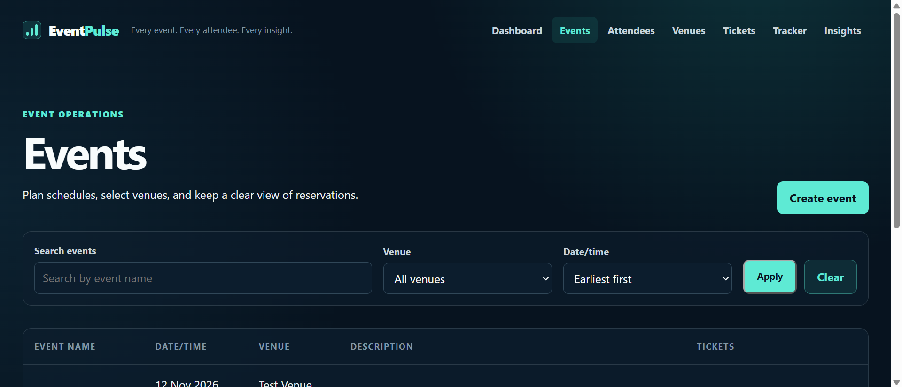
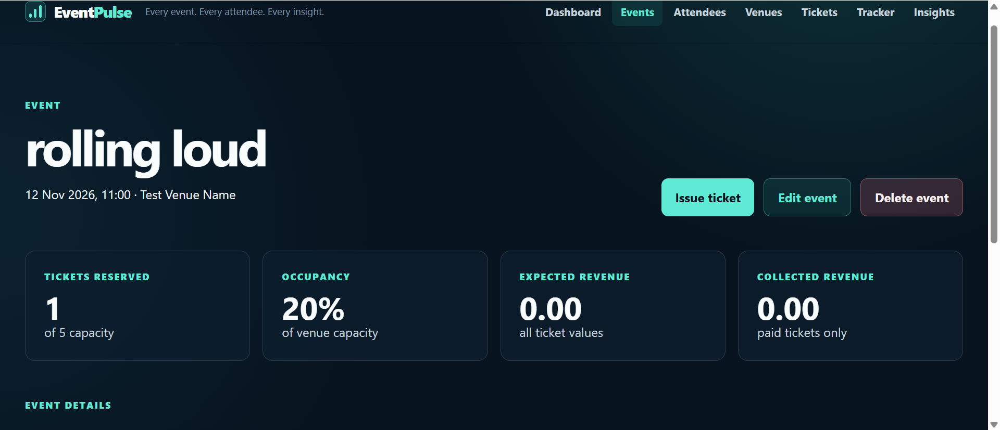
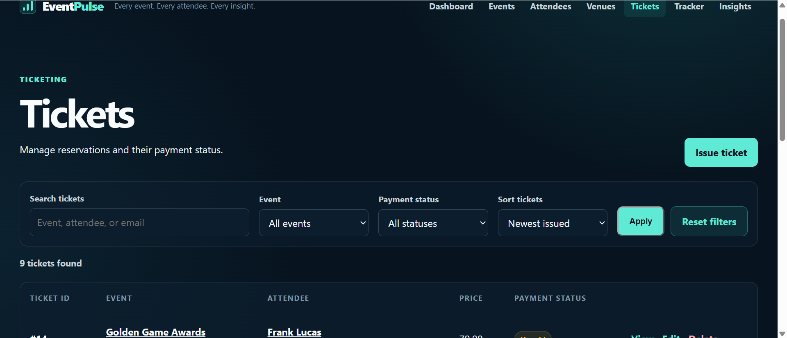
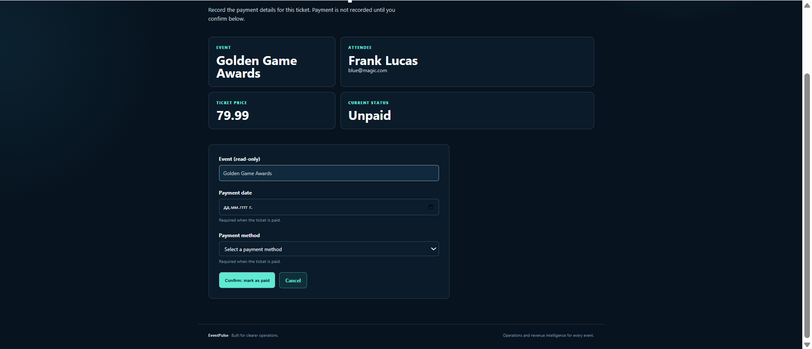
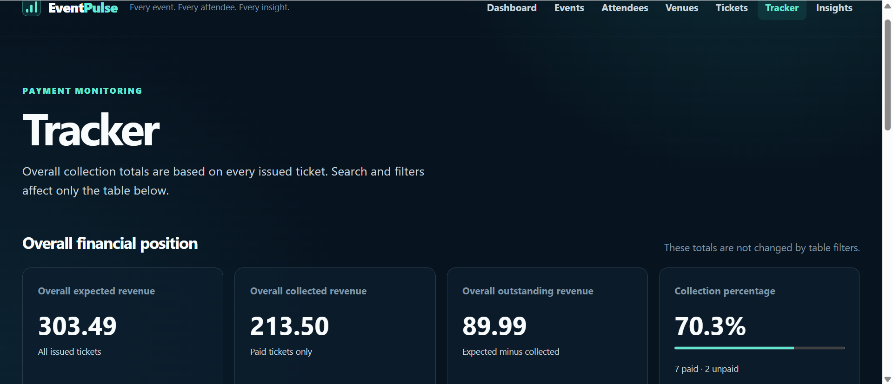
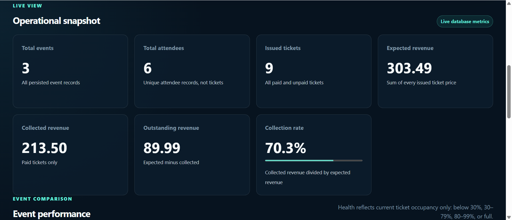
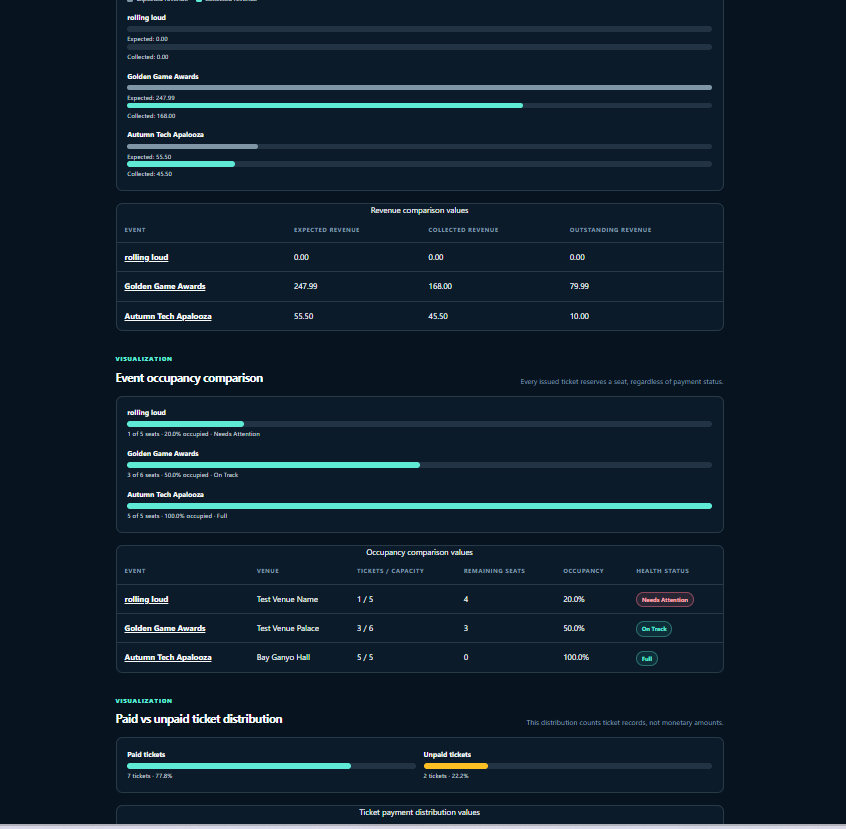

# EventPulse Evaluator Walkthrough

This walkthrough uses only the public application UI after a fresh local setup:

```powershell
python manage.py migrate
python manage.py runserver
```

Open <http://127.0.0.1:8000/>. No Django Admin, fixture, or direct database insertion is required.

## 1. Create a venue

1. Open **Venues** in the primary navigation and select **Create venue**.
2. Enter a name, address, and a capacity such as `2`; the description is optional.
3. Save the venue.

Expected result: the venue detail page opens and the venue is available for event creation. A capacity below one is rejected. This demonstrates venue validation and the capacity context used by each event.

## 2. Create an event

1. Open **Events** and select **Create event**.
2. Enter an event name, start date/time, description, and select the venue created above.
3. Save the event.

Expected result: the event detail page shows its venue, initial zero-ticket occupancy, and revenue figures. The **Issue ticket** action can preselect this event. This demonstrates the Venue-to-Event relationship and schedule workflow.



*Events list — the list controls and event-management entry point.*



*Event detail — a live event view with venue capacity and event-level financial metrics.*

## 3. Create attendees

1. Open **Attendees** and select **Add attendee**.
2. Create an attendee with a unique email address and a valid phone number.
3. Repeat once to create a second attendee.

Expected result: attendee detail pages list their ticket relationships once tickets exist. The duplicate-email and phone validation messages are server-side safeguards.

## 4. Issue a ticket

1. Open **Tickets** and select **Issue ticket**.
2. Select the event and first attendee, enter a non-negative price, retain **Unpaid**, and leave payment fields empty.
3. Save the ticket.

Expected result: ticket detail shows the reservation, payment status, venue, and attendee. This demonstrates ticket CRUD, the Event/Attendee through relationship, and the rule that an unpaid reservation still occupies a seat.



*Tickets — reservation records and payment-status management controls.*

## 5. Demonstrate duplicate-ticket rejection

1. Return to **Issue ticket**.
2. Select the same event and the same attendee as in step 4.
3. Submit the form.

Expected result: the form rejects the submission because one attendee may have only one ticket for the same event. No second ticket is created.

## 6. Demonstrate venue-capacity handling

1. Issue a ticket for the second attendee and the same event.
2. With the example capacity of `2`, attempt to issue another ticket for a third attendee and that event.

Expected result: the first two tickets are allowed; the next ticket is rejected as the event venue is full. Capacity is evaluated per event, so a separate event at the same venue has its own capacity allocation.

## 7. Record and reverse payment status

1. Open a ticket detail, or use **Tracker**.
2. Select **Mark as paid**, provide a payment date and method, and confirm.
3. Verify the ticket now shows Paid with those details.
4. Select **Mark as unpaid** and confirm.

Expected result: marking paid requires both payment fields. Marking unpaid clears the current payment metadata. The disabled **Event (read-only)** field on the paid form is informational and cannot change the ticket's event.



*Mark as Paid — authentic payment-status form with its disabled informational event field.*

## 8. Inspect Tracker metrics

1. Open **Tracker**.
2. Review overall Expected Revenue, Collected Revenue, Outstanding Revenue, Collection Percentage, and paid/unpaid counts.
3. Use the text, event, and payment-status filters; then reset them.

Expected result: filters narrow only the payment-record table. The KPI totals remain overall totals. Expected revenue includes all tickets; collected revenue includes paid tickets only.



*Tracker — overall financial totals remain independent of table filters.*

## 9. Inspect Dashboard KPIs and Event Health

1. Open **Dashboard**.
2. Review total events/attendees, overall financial KPIs, and the per-event performance table.

Expected result: each event displays tickets/capacity, occupancy, expected/collected/outstanding amounts, and Health. Health is occupancy-only: below 30% Needs Attention, 30–<80% On Track, 80–<100% Near Capacity, and 100% Full.



*Dashboard — live operational snapshot and entry point to event-performance reporting.*

## 10. Inspect Insights and filtering

1. Open **Insights**.
2. Review revenue comparison, occupancy comparison, and paid/unpaid distribution charts with their accessible table equivalents.
3. Select one event in the event filter and apply it.

Expected result: the Insights scope changes to the selected event and the charts/tables and scoped metrics update. The page remains useful with no records because it supplies zero-safe metrics and creation-oriented empty states.



*Insights — chart visualizations are paired with exact tabular values.*

## 11. Demonstrate the custom 404 page

1. Navigate to an unknown route, for example <http://127.0.0.1:8000/not-a-real-route/>.

Expected result: EventPulse renders its branded “This route is not on the event plan.” page with a Dashboard link. The custom handler is configured in the root URL configuration; its production-like behavior is covered by an automated `DEBUG=False` test.


